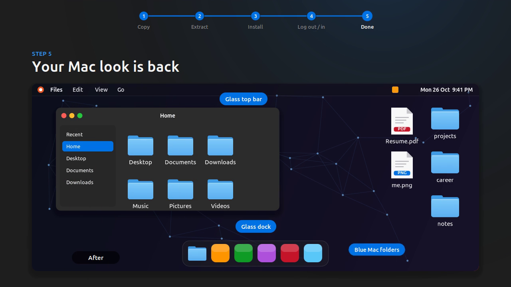
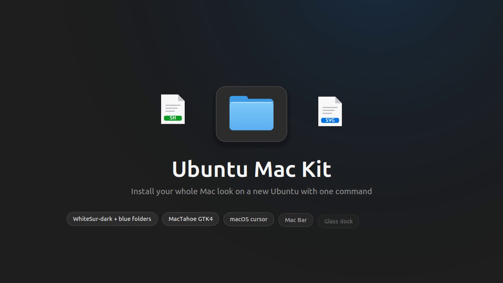

# Ubuntu Mac Kit

A portable, one-command installer for a complete macOS-style desktop on Ubuntu 24.04 (GNOME 46).
Mac Bar also supports GNOME 47 and 48.
Copy one archive to a new machine, run `./install.sh`, log out and back in.

[](LICENSE)


[](https://github.com/chhari07/ubuntu-mac-kit/actions/workflows/lint.yml)



[](docs/media/install-walkthrough.mp4)

*Install walkthrough, 58 seconds. Select the image to play.*

## Contents

- [What it installs](#what-it-installs)
- [Requirements](#requirements)
- [Installation](#installation)
- [Options](#options)
- [Uninstalling](#uninstalling)
- [How it works](#how-it-works)
- [Repository layout](#repository-layout)
- [Building the release bundle](#building-the-release-bundle)
- [Troubleshooting](#troubleshooting)
- [Credits](#credits)
- [License](#license)

## What it installs

| Component | Details |
| --- | --- |
| Icon theme | WhiteSur-dark, with regenerated blue macOS folders and white page file icons (PDF, PNG, ZIP, DOCX and about 900 more) |
| Cursor | macOS cursor theme (apple_cursor) |
| GTK styling | Yaru-blue-dark for GTK 3, MacTahoe styling for GTK 4 / libadwaita apps, dark mode |
| Window controls | Close, minimize and maximize on the left |
| Mac Bar | GNOME Shell extension: translucent blurred top bar, Ubuntu logo menu, clock on the right, sticky-notes button |
| Dock | Glass dock along the bottom, 30% opacity, 48 px icons |
| Sticky Notes | Transparent desktop notes, toggled from the top bar |
| Files icon | Blue macOS folder for the Files app in the dock |
| Icon lock | A small user service that keeps the icon theme selected when Ubuntu Settings tries to reset it |

Everything is installed into your home folder. `sudo` is never used and no system files are changed.

## Requirements

- Ubuntu 24.04 LTS with the default GNOME Shell 46 session (Wayland or X11)
- About 150 MB of free space
- Optional, for Sticky Notes: `python3-gi` and `gir1.2-gtk-3.0` (installed by default on Ubuntu)

Ubuntu 24.04 with GNOME 46 is the tested platform. Mac Bar also declares support for GNOME 47 and 48 (for example
Ubuntu 24.10 and 25.04), which use the same panel APIs. On other versions the theme and settings are applied and
Mac Bar is skipped unless `--force-extension` is given.

## Installation

1. Download `ubuntu-mac-kit.tar.gz` from the [latest release](https://github.com/chhari07/ubuntu-mac-kit/releases/latest).
   The release bundle includes the theme files. A plain clone of this repository does not.

2. Extract it and run the installer:

   ```bash
   tar -xzf ubuntu-mac-kit.tar.gz
   cd ubuntu-mac-kit
   ./install.sh
   ```

3. Log out and log back in. This loads the Mac Bar extension and refreshes every app.

To preview the changes first, run `./install.sh --dry-run`.

Optionally verify the download:

```bash
sha256sum -c ubuntu-mac-kit.tar.gz.sha256
```

## Options

| Option | Description |
| --- | --- |
| `-y`, `--yes` | Do not ask for confirmation |
| `-n`, `--dry-run` | Print every action without changing anything |
| `--wallpaper FILE` | Also copy `FILE` into your home folder and set it as the wallpaper |
| `--no-extension` | Skip the Mac Bar top-bar extension |
| `--no-notes` | Skip the Sticky Notes app |
| `--no-icon-lock` | Skip the icon-lock service |
| `--force-extension` | Enable Mac Bar on GNOME Shell versions other than 46 to 48 |

## Uninstalling

```bash
cd ubuntu-mac-kit
./uninstall.sh
```

The uninstaller stops the icon lock, restores every GNOME setting to the value it had before installation,
removes the files the kit added and puts back any files it replaced. Log out and back in afterwards.

## How it works

- **Backups.** Before a setting is changed, its current value is saved to
  `~/.local/share/ubuntu-mac-kit/settings.backup`. Before a file or folder is replaced, the original is moved to
  `~/.local/share/ubuntu-mac-kit/backup/`. Running the installer again does not overwrite these originals.
- **Manifest.** Every path the kit creates or replaces is listed in `~/.local/share/ubuntu-mac-kit/manifest`.
  The uninstaller works through this list in reverse.
- **Extensions.** Mac Bar is appended to `enabled-extensions`. On uninstall only Mac Bar is removed from that list,
  so extensions you enabled later stay on.
- **Icon lock.** Ubuntu Settings > Appearance switches the icon theme back to Yaru when a style or accent colour is
  selected. The `keep-mac-icons` user service watches that setting and restores WhiteSur-dark. Disable it with
  `systemctl --user disable --now keep-mac-icons`.
- **Settings.** All GNOME settings are listed in [`config/settings.conf`](config/settings.conf) and can be edited before
  installing.

## Repository layout

```
ubuntu-mac-kit/
├── install.sh                  Installer
├── uninstall.sh                Uninstaller
├── lib/common.sh               Shared paths and helpers
├── config/
│   ├── settings.conf           GNOME settings applied by the installer
│   ├── keep-mac-icons          Icon-lock script
│   └── keep-mac-icons.service  Icon-lock systemd user unit
├── extension/macbar@ubuntu-mac-kit  Mac Bar GNOME Shell extension
├── apps/desktop-note/note.py   Sticky Notes app
├── assets/files-folder.svg     Files app icon
├── design/                     Design tokens (Figma Tokens format) and theme specification
├── docs/media/                 Screenshots and walkthrough video
└── tools/
    ├── build-bundle.sh         Builds the release archive
    ├── mac-file-icons-gen.py   Generates the macOS folder and file icons
    ├── make_video.py           Renders the walkthrough video
    └── make_audio.py           Synthesises the walkthrough soundtrack
```

The release archive also contains `payload/`, which holds the third-party theme files.

## Building the release bundle

Run this on a machine where the finished theme is installed:

```bash
tools/build-bundle.sh
```

It combines the committed repository files with `payload/` (WhiteSur, WhiteSur-dark, macOS cursor and the GTK 4
styling) and writes `dist/ubuntu-mac-kit.tar.gz` and its SHA-256 checksum.

To regenerate the folder and file icons on a stock WhiteSur-dark theme:

```bash
python3 tools/mac-file-icons-gen.py ~/.local/share/icons/WhiteSur-dark --install
gtk-update-icon-cache -f ~/.local/share/icons/WhiteSur-dark
```

To render the walkthrough video (requires `python3-cairo` and `ffmpeg`):

```bash
python3 tools/make_audio.py soundtrack.wav
python3 tools/make_video.py silent.mp4
ffmpeg -i silent.mp4 -i soundtrack.wav -c:v copy -c:a aac -shortest install-walkthrough.mp4
```

## Troubleshooting

| Problem | Solution |
| --- | --- |
| Top bar is unchanged | Log out and back in. On Wayland, extensions only load at login. Check with `gnome-extensions info macbar@ubuntu-mac-kit`. |
| Icons switch back to Yaru | Check the icon lock: `systemctl --user status keep-mac-icons` |
| Some apps keep the old style | Close and reopen them, or log out and back in |
| Sticky Notes button does nothing | Install PyGObject: `sudo apt install python3-gi gir1.2-gtk-3.0` |
| Files icon reverted after an update | Run `./install.sh` again |

## Credits

This kit bundles and configures the following open-source projects. See [THIRD_PARTY.md](THIRD_PARTY.md).

- [WhiteSur icon theme](https://github.com/vinceliuice/WhiteSur-icon-theme) by Vince Liuice, GPL-3.0
- [MacTahoe GTK theme](https://github.com/vinceliuice/MacTahoe-gtk-theme) by Vince Liuice, GPL-3.0
- [apple_cursor](https://github.com/ful1e5/apple_cursor) by Abdulkaiz Khatri, GPL-3.0

This project is not affiliated with or endorsed by Apple Inc. or Canonical Ltd.
macOS is a trademark of Apple Inc. Ubuntu is a trademark of Canonical Ltd.

## License

Released under the [GNU General Public License v3.0](LICENSE).
Copyright (C) 2026 Aman Kumar Chhari.
